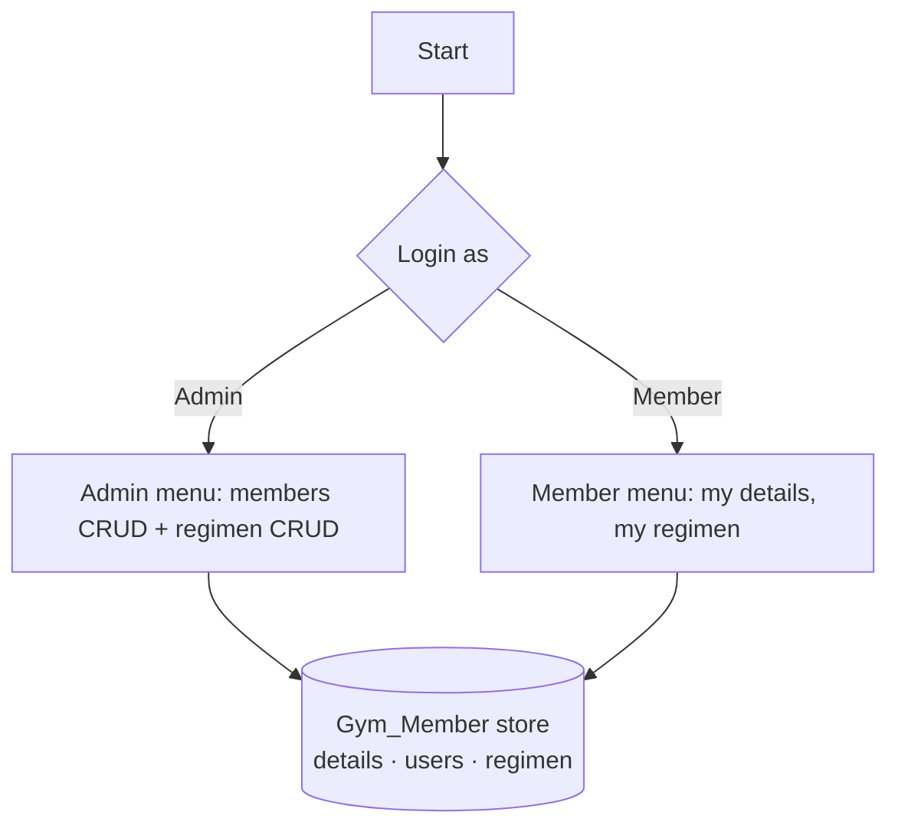

<h1 align="center">🏋️ Edyoda Gym: Member Management Program</h1>

<p align="center">
  <b>A gym management system in Python with two roles: an admin who manages members and workout plans, and members who sign in to see their own details and weekly regimen. Plans are generated from each member's BMI.</b>
</p>

<p align="center">
  
  
  
  
</p>

---

## ✨ Features

| Role | Can do |
|---|---|
| **Admin (super user)** | Create, view, update and delete **members** · create, view, update and delete **workout regimens** |
| **Member** | Sign in with membership ID + PIN · view own profile · view own weekly regimen |

**BMI-based regimen.** When a member joins, the program computes **BMI = weight ÷ height²** and assigns a weekly plan:

| BMI | Plan focus |
|---|---|
| under 18.5 | Strength days with extra rest |
| 18.5 – 25 | Balanced split, cardio/abs mid-week |
| 25 – 30 | More cardio, Sunday cardio |
| 30 and over | Cardio on three days |

New members get an auto-incrementing **membership ID** and a random 4-digit **PIN**.

## 🧠 How it works



- **`ed_gym/data_store.py`** holds the `Gym_Member` class: member records, admin and member logins, regimens, the BMI calculator and the regimen rules.
- **`main.py`** is the role-based menu: it checks credentials, then shows the admin or member options.

## ▶️ Run it

```bash
python main.py
```

Demo logins (sample data, built into the program):

| Role | Username | Password |
|---|---|---|
| Admin | `admin123` | `123admin` |
| Member 1 | `1000000` | `1234` |
| Member 2 | `1000001` | `4321` |

## 🎯 What this project shows

`CRUD operations` · `role-based access` · `OOP (class as a data store)` · `packages and modules` · `nested dictionaries` · `rule-based logic (BMI bands)` · `random ID/PIN generation`

## 💬 Interview questions this project answers

<details>
<summary><b>What is CRUD, and where is it here?</b></summary>

Create, Read, Update, Delete: the four operations on any stored record. The admin menu has all four for both members and regimens; the member menu has Read only, which is the role-based access part.
</details>

<details>
<summary><b>How would you store passwords properly?</b></summary>

Never in plain text. Store a salted hash (bcrypt or argon2) and compare hashes at login; lock the account after repeated failures. Here PINs are plain values in a dictionary, which is fine for a demo but not for real members.
</details>

<details>
<summary><b>Why separate <code>data_store.py</code> from <code>main.py</code>?</b></summary>

Separation of concerns: the data and rules live in one module, the menus in another. You could replace the CLI with a web page or swap the dictionaries for a database without touching the other half.
</details>

## 🛠️ Next steps (honest)

- **Persistence:** data lives in memory; SQLite or JSON files would keep it between runs.
- **Hashed PINs** instead of plain values.
- **Input validation:** weight and height must be positive numbers; the duration should be one of 1, 3, 6 or 12.
- **Sample data:** the built-in sample members use realistic-looking contact details; dummy values would be safer in a public repository.
- **Tests** for the BMI bands and the CRUD paths.

---

<p align="center"><sub>Built by <a href="https://github.com/abhishekvtiwari">Abhishek Tiwari</a> · Python project from the Edyoda programme</sub></p>
